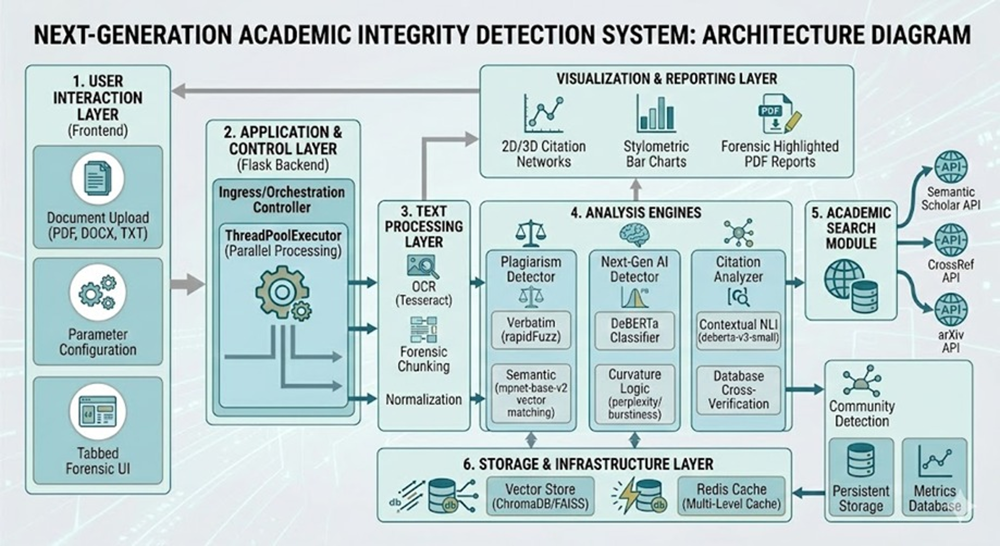

# 🛡️ Next-Generation Academic Integrity Verification System

[](https://www.python.org/)
[](https://flask.palletsprojects.com/)
[](https://pytorch.org/)
[](https://huggingface.co/)
[](#publication--authors)

A multi-layered forensic academic integrity platform that unifies **Semantic Plagiarism Detection**, **AI-Generated Content Identification**, and **Natural Language Inference (NLI) Citation Verification** into a single automated pipeline with Turnitin-style color-coded PDF reporting.

---

## 📋 Table of Contents

- [Overview & Motivation](#-overview--motivation)
- [System Architecture](#-system-architecture)
- [Core Detection Modules](#-core-detection-modules)
- [Performance & Evaluation Metrics](#-performance--evaluation-metrics)
- [Project Structure](#-project-structure)
- [Installation & Setup](#-installation--setup)
- [REST API Reference](#-rest-api-reference)
- [Forensic PDF Highlight Legend](#-forensic-pdf-highlight-legend)
- [Publication & Authors](#-publication--authors)

---

## 🎯 Overview & Motivation

Traditional string-matching plagiarism tools fail against modern academic integrity challenges:
* **AI-Assisted Paraphrasing ("Idea Theft"):** Rewriting stolen concepts using LLMs bypasses exact lexical matching.
* **Hallucinated & Misleading Citations:** Checking only whether a DOI or reference exists fails to verify whether the cited work actually supports the author's claim.
* **False Positives on Technical Writing:** Standard AI classifiers frequently misclassify formal, domain-heavy human scholarship as machine-generated.

This system solves all three problems through a multi-layer forensic architecture backed by a **Flask REST API** and multi-backend scholarly search (**Semantic Scholar, CrossRef, arXiv, and OpenAlex**).

---

## 🏗️ System Architecture



---

## 🔬 Core Detection Modules

### 1. Semantic Plagiarism & Idea Theft Detector (`plagiarism.py`)
* **Manifold Alignment:** Encodes document chunks and candidate abstracts into dense semantic vectors using `paraphrase-multilingual-mpnet-base-v2` (Siamese SBERT) combined with lexical overlap and cross-encoder reranking.
* **Domain-Aware Database Routing:** Classifies chunk domains (`computer_science`, `medical`, `physics`, `legal`, `business`, `general`) to prioritize relevant scholarly APIs.
* **Auto-Calibrated Thresholds (ACT):** Dynamically computes baseline thresholds ($\mu + 1.5\sigma$) and applies contextual adjustments for properly cited passages, short chunks, and high technical-term density to prevent false flags.

### 2. Next-Gen AI Content Identifier (`ai_detector.py`)
* **Probability Curvature & Token Entropy:** Uses causal language modeling (`Qwen/Qwen2.5-0.5B`) to evaluate log-likelihood, perplexity, and predictive entropy across sentences.
* **Supervised Transformer Classification:** Ensembles LM curvature signals with `desklib/ai-text-detector-v1.01` (`0.25` Perplexity + `0.35` Entropy + `0.40` Classifier).
* **Linguistic Stylometric Fingerprinting:** Computes sentence length **Burstiness** (standard deviation of sentence lengths), **Lexical Diversity** (Type-Token Ratio), and **Average Sentence Length** to distinguish natural human rhythm from uniform LLM output.

### 3. NLI Citation Integrity Analyzer (`citation_analyzer.py`)
* **Multi-Style Citation Extraction:** Detects Author-Year (`Smith (2020)`), Parenthetical (`(Smith et al., 2020)`), Bracketed (`[1, 2]`), and raw DOI strings alongside a 300-character surrounding claim window.
* **Natural Language Inference (NLI) Fact-Checking:** Uses `cross-encoder/nli-deberta-v3-small` to test whether the retrieved source abstract (**premise**) supports the manuscript's claim (**hypothesis**), classifying citations into:
  * `Entailment` (Valid support)
  * `Contradiction` (Fraudulent / Misrepresented source)
  * `Neutral` (Irrelevant citation)
  * `Source Not Found` (Unverifiable / Hallucinated reference)

### 4. Interactive Citation Network & Reporting (`graph_visualizer.py`, `report_generator.py`)
* **Network Analytics:** Builds directed citation graphs (`NetworkX`) with PageRank, betweenness centrality, community detection, and interactive 2D/3D Plotly visualizations.
* **Forensic PDF Export:** Generates annotated PDFs with color-coded highlights and an executive coverage summary header.

---

## 📊 Performance & Evaluation Metrics

| Evaluation Metric | Score | Description |
| :--- | :---: | :--- |
| **Overall System Accuracy** | **89.0%** | Weighted multi-engine forensic accuracy across AI, plagiarism, and citation checks |
| **System Precision** | **0.90** | High false-alarm control to protect genuine human academic writing |
| **System Recall** | **0.83** | Strong detection rate across paraphrased text and subtle citation contradictions |
| **Overall F1-Score** | **0.85** | Balanced harmonic mean of precision and recall |
| **Plagiarism Engine Accuracy** | **88.0%** | Evaluated via Siamese SBERT manifold alignment & ACT filtering |
| **AI Detection Accuracy** | **85.0%** | Evaluated via Qwen2.5 curvature + Desklib ensemble + stylometrics |
| **Citation NLI Accuracy** | **82.0%** | Evaluated via DeBERTa-v3 claim-to-abstract entailment verification |

---

## 📁 Project Structure

```text
Plagiarism-Detection-PAPER-1/
├── app.py                     # Main Flask web application, REST routes & orchestration engine
├── text_processing.py         # Multi-format parser (PDF, DOCX, TXT) & Tesseract image OCR
├── plagiarism.py              # SBERT manifold alignment, domain routing & ACT thresholding
├── ai_detector.py             # Qwen2.5 perplexity/entropy, Desklib classifier & stylometrics
├── citation_analyzer.py       # Regex citation extractor & DeBERTa-v3 NLI claim verifier
├── academic_search.py         # Multi-API client (Semantic Scholar, CrossRef, arXiv, OpenAlex) + FAISS/Redis
├── graph_visualizer.py        # 2D/3D Plotly & Matplotlib citation network & community graphs
├── report_generator.py        # Turnitin-style color-coded PDF report generator (PyMuPDF)
├── evaluation.py              # Evaluation metrics & evidence table generators
├── image-3.png                # System architecture diagram
├── templates/                 # HTML frontend templates
└── static/                    # CSS, JavaScript & UI assets

### System-Wide Performance
```
Overall System Accuracy :  89.0%
System Precision        :  0.900  (Minimizes false accusations on human work)
System Recall           :  0.830  (Captures heavily paraphrased text)
Overall F1-Score        :  0.850  (Balanced forensic reliability)
```

---

## 🛠️ Tech Stack

- **Core Backend**: Python 3.9+, Flask
- **Deep Learning / NLP**: PyTorch, Hugging Face `transformers`, `sentence-transformers`
- **Search & Vector Indexing**: FAISS, Redis, Requests HTTP Pool
- **Visualization**: Plotly, Matplotlib, NetworkX, Seaborn
- **PDF & Document Engine**: PyMuPDF (`fitz`), `python-docx`, `pytesseract`
- **Frontend**: HTML5, CSS3, JavaScript (ES6+), Tailwind / Custom Component Styling

---

## 🚀 Installation & Setup

### Prerequisites
- Python 3.9 or higher
- Tesseract OCR engine (Optional, for scanned PDF OCR support)
- Redis server (Optional, for multi-level query caching)

### 1. Clone the Repository
```bash
git clone https://github.com/your-username/academic-integrity-suite.git
cd academic-integrity-suite
```

### 2. Create and Activate Virtual Environment
```bash
# On Linux/macOS
python3 -m venv venv
source venv/bin/activate

# On Windows
python -m venv venv
venv\Scripts\activate
```

### 3. Install Dependencies
```bash
pip install --upgrade pip
pip install -r requirements.txt
```

### 4. Run the Application
```bash
python app.py
```
Open `http://127.0.0.1:5000` in your web browser.

---

## 📡 API Reference

### 1. Single Document Analysis
- **Endpoint**: `POST /analyze`
- **Content-Type**: `multipart/form-data`
- **Body**: `file` (PDF, DOCX, TXT)
- **Response**: JSON containing raw text, AI metrics, plagiarism matches, citation entailment status, and evaluation tables.

### 2. Batch Analysis
- **Endpoint**: `POST /analyze-batch`
- **Content-Type**: `multipart/form-data`
- **Body**: `files` (Multiple documents)
- **Response**: Comparative document risk matrix and aggregate statistics.

### 3. Export PDF Report
- **Endpoint**: `POST /generate-report`
- **Content-Type**: `multipart/form-data`
- **Form Data**: `file`, `report_type` (`full`, `ai`, `plagiarism`, `citations`)
- **Response**: Downloadable highlighted PDF document.

---

## 📄 Forensic PDF Reporting

The suite includes an automated PDF generation engine powered by PyMuPDF:
- 🟨 **Yellow Highlights**: Verbatim and semantic plagiarism matches.
- 🟦 **Cyan Highlights**: Passages identified as AI-generated.
- 🟥 **Red Highlights**: Citation contradictions and unverified claims.
- 📋 **Header Summary Box**: Embeds target vs. observed highlight coverage metadata.

---

## 📜 Research & Publications

This framework was presented at the **International Conference on FutureTech: AI-Driven Innovations for Sustainable Development Goals (FutureTech - 2025)**:

- **Paper Title**: *Comprehensive Academic Integrity Verification: Plagiarism, AI-Content and Citation Analysis*
- **Publication Partners**: SSRN / Elsevier
- **Organized By**: Institute of Technical and Scientific Research (ITSR), Jaipur, India (Dec 22-23, 2025)

---

## 👥 Contributors

- **Hariharan K** (Reg No: 312422243050) – St. Joseph's Institute of Technology
- **Harish B** (Reg No: 312422243053) – St. Joseph's Institute of Technology
- **Guided By**: Dr. M.K. Kirubakaran, M.E., Ph.D.

---

## 📝 License

Distributed under the MIT License. See `LICENSE` for more information.
